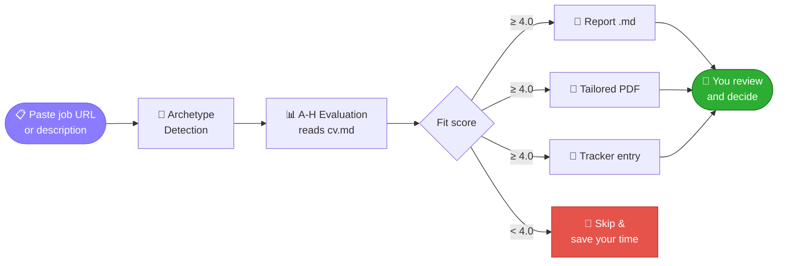

<!-- ===================== HEADER BANNER ===================== -->
<p align="center">
  
</p>

<!-- ===================== TYPING ANIMATION ===================== -->
<p align="center">
  <a href="https://github.com/<your-username>/RESUME_TAILOR.dev">
    
  </a>
</p>

<!-- ===================== BADGES ===================== -->
<p align="center">
  
  
  
  
  
</p>

<p align="center">
  
  
  
  
</p>

<p align="center">
  <b>Created &amp; maintained by Muzammil</b>
</p>

<p align="center">
  <a href="#-quick-start">Quick Start</a> •
  <a href="#-features">Features</a> •
  <a href="#-how-it-works">How It Works</a> •
  <a href="#-usage">Usage</a> •
  <a href="#-tech-stack">Tech Stack</a> •
  <a href="#-faq">FAQ</a> •
  <a href="#-about-the-author">Author</a>
</p>

---

## ✨ What Is This?

**RESUME_TAILOR.dev** turns any AI coding CLI into a full job-search command center. Instead of tracking applications in a spreadsheet and rewriting your CV by hand for every posting, you get an AI-powered pipeline that does the heavy lifting, while **you** keep the final say.

| 😩 Without RESUME_TAILOR.dev | 🚀 With RESUME_TAILOR.dev |
| --- | --- |
| One generic resume sent everywhere | A tailored, ATS-optimized CV for every job |
| Guessing which jobs are worth applying to | A 1-5 fit score with a structured report |
| Messy spreadsheet of applications | One tracker with dedup and integrity checks |
| Checking career pages by hand | Automatic portal scanning |
| Applying and hoping | Company research + the right person to contact |

> [!IMPORTANT]
> **This is NOT a spray-and-pray tool.** RESUME_TAILOR.dev is a *filter*. It helps you find the few offers worth your time out of hundreds, and it recommends against applying to anything scoring below **4.0 / 5**. Always review before submitting.

> [!TIP]
> **The first evaluations won't be great.** The system doesn't know you yet. Feed it context: your CV, projects, proof points, preferences, strengths and dealbreakers. The more you teach it, the sharper it gets.

---

## 🎯 Features

<table>
  <tr>
    <td width="50%" valign="top">

### 🤖 Auto-Pipeline
Paste a job URL and get a full evaluation, a tailored PDF and a tracker entry in one go.

### 📊 A-H Evaluation
Role summary, CV match, level strategy, compensation research, personalization, interview prep (STAR+R) and a **posting-legitimacy check** that flags scams and ghost jobs.

### 📄 ATS PDF Generation
Keyword-injected CVs rendered from an HTML template via Playwright.

### ✉️ Cover Letters &amp; Email Drafts
Research-backed cover letters (A4 PDF) and recruiter / referral / cold emails with a subject line and attachment checklist. **Draft-only. Nothing is ever sent for you.**

    </td>
    <td width="50%" valign="top">

### 🔍 Portal Scanner
Pre-configured companies plus custom queries across Greenhouse, Ashby, Lever and more.

### ⚡ Batch Processing
Evaluate many offers in parallel with headless CLI workers.

### 🖥️ Dashboard TUI
A terminal UI to browse, filter and sort your whole pipeline.

### 🎤 Interview Suite
Story bank (STAR+Reflection), time-blocked prep plans, practice sessions with feedback and post-interview debriefs.

### 💰 Negotiation Scripts
Salary negotiation frameworks and counter-offer leverage.

### 🛡️ Pipeline Integrity
Automated merge, dedup, status normalization and health checks.

    </td>
  </tr>
</table>

> [!NOTE]
> **Human-in-the-Loop by design.** The AI evaluates and recommends. You decide and act. The system never submits an application.

---

## 🧠 How It Works



---

## 🚀 Quick Start

```bash
# 1️⃣  Clone and install
git clone https://github.com/<your-username>/RESUME_TAILOR.dev.git
cd RESUME_TAILOR.dev && npm install
npx playwright install chromium   # only needed for PDF generation

# 2️⃣  Check setup
npm run doctor

# 3️⃣  Configure
cp config/profile.example.yml config/profile.yml   # edit with your details
cp templates/portals.example.yml portals.yml        # customize companies

# 4️⃣  Add your CV
#     Create cv.md in the project root with your CV in markdown

# 5️⃣  Open your AI CLI in this directory
claude   # or codex / opencode / qwen / agy / grok

# 6️⃣  Start using
#     Paste a job URL or JD text to trigger the auto-pipeline
```

On first launch, the system walks you through setup (your CV, profile and target roles) just by chatting.

> [!TIP]
> The system is designed to be customized by your AI CLI itself. Modes, archetypes, scoring weights and scripts: just ask it to change them.

---

## 🎮 Usage

<details open>
<summary><b>Slash commands</b> (for CLIs that register them)</summary>

<br/>

| Command | What it does |
| --- | --- |
| `/career-ops` | Show all available commands |
| `/career-ops {paste a JD}` | Full auto-pipeline (evaluate + PDF + tracker) |
| `/career-ops scan` | Scan portals for new offers |
| `/career-ops pdf` | Generate an ATS-optimized CV |
| `/career-ops cover` | Cover letter generator |
| `/career-ops email` | Application email draft (draft-only) |
| `/career-ops batch` | Batch evaluate multiple offers |
| `/career-ops tracker` | View application status |
| `/career-ops pipeline` | Process pending URLs |
| `/career-ops contacto` | Find hiring manager / recruiter + draft a LinkedIn message |
| `/career-ops deep` | Structured company research prompt |

</details>

> In Codex, slash commands are not guaranteed. Ask in plain language instead, for example: *"Run the scan mode and summarize new matches."*

---

## 🧰 Tech Stack

<p align="center">
  
</p>

| Layer | Technology |
| --- | --- |
| 🤖 **Agent** | AI coding CLI with shared skills and modes |
| 📄 **PDF** | Playwright + HTML template |
| 🔍 **Scanner** | Playwright + Greenhouse API + web search |
| 🖥️ **Dashboard** | Go + Bubble Tea + Lipgloss |
| 🗄️ **Data** | Markdown tables + YAML config + TSV batch files |

---

## 📁 Project Structure

<details>
<summary><b>Click to expand</b></summary>

```
RESUME_TAILOR.dev/
├── AGENTS.md                    # Agent instructions (all CLIs)
├── cv.md                        # Your CV (create this)
├── article-digest.md            # Your proof points (optional)
├── config/
│   └── profile.example.yml      # Template for your profile
├── modes/                       # Skill modes (evaluation, pdf, cover, scan, batch...)
├── templates/
│   ├── cv-template.html         # ATS-optimized CV template
│   ├── portals.example.yml      # Scanner config template
│   └── states.yml               # Canonical statuses
├── batch/                       # Batch prompt and runner
├── dashboard/                   # Go TUI pipeline viewer
├── data/                        # Your tracking data (gitignored)
├── reports/                     # Evaluation reports (gitignored)
├── output/                      # Generated PDFs (gitignored)
├── fonts/                       # CV fonts
├── docs/                        # Setup and architecture docs
└── examples/                    # Sample CV, report, proof points
```

</details>

---

## ❓ FAQ

<details>
<summary><b>Does RESUME_TAILOR.dev apply to jobs for me?</b></summary>

No. It evaluates, ranks and drafts. You review and decide. It never submits, sends or clicks anything on your behalf.

</details>

<details>
<summary><b>Which AI CLIs does it work with?</b></summary>

Any major AI coding CLI that supports agent skills: Claude Code, Codex, Antigravity, OpenCode, Grok, Qwen and others.

</details>

<details>
<summary><b>Can I run it cheaply?</b></summary>

Yes. It can run on free-tier or local models. See the `docs/` folder for budget setup notes.

</details>

---

## 👨‍💻 About the Author

<table>
  <tr>
    <td>

Hi, I'm **Muzammil** 👋

A Computer Science graduate from **Sir Syed University of Engineering &amp; Technology (SSUET), Karachi**. I work across mobile development, AI integration and data analytics. I built RESUME_TAILOR.dev to make tailoring a CV to every job faster and smarter.

<p>
  
  
  
  
  
  
  
  
</p>

    </td>
  </tr>
</table>

### 🤝 Let's Connect

<p align="center">
  <a href="https://github.com/<your-username>"></a>
  <a href="https://linkedin.com/in/<your-handle>"></a>
  <a href="mailto:<your-email>"></a>
</p>

---

## ⚠️ Disclaimer

**RESUME_TAILOR.dev is a local, open-source tool, NOT a hosted service.** By using it, you acknowledge:

1. **You control your data.** Your CV and personal data stay on your machine and are sent directly to the AI provider you choose. No data is collected or stored by this project.
2. **You control the AI.** The default prompts instruct the AI not to auto-submit applications, but AI models can behave unpredictably. **Always review AI-generated content for accuracy before submitting.**
3. **You comply with third-party ToS.** Use this tool in accordance with the Terms of Service of the career portals you interact with. Do not use it to spam employers or overwhelm ATS systems.
4. **No guarantees.** Evaluations are recommendations, not truth. AI models may hallucinate skills or experience. The author is not liable for employment outcomes.

---

## 📜 License &amp; Acknowledgements

Released under the [MIT License](LICENSE). RESUME_TAILOR.dev is built on top of the open-source [career-ops](https://github.com/santifer/career-ops) project by Santiago Fernández de Valderrama Aparicio (MIT). The original copyright and license notice are retained in the `LICENSE` file, as the MIT License requires.

<p align="center">
  <b>⭐ If this helps your job search, give the repo a star! ⭐</b>
</p>

<!-- ===================== FOOTER WAVE ===================== -->
<p align="center">
  
</p>
